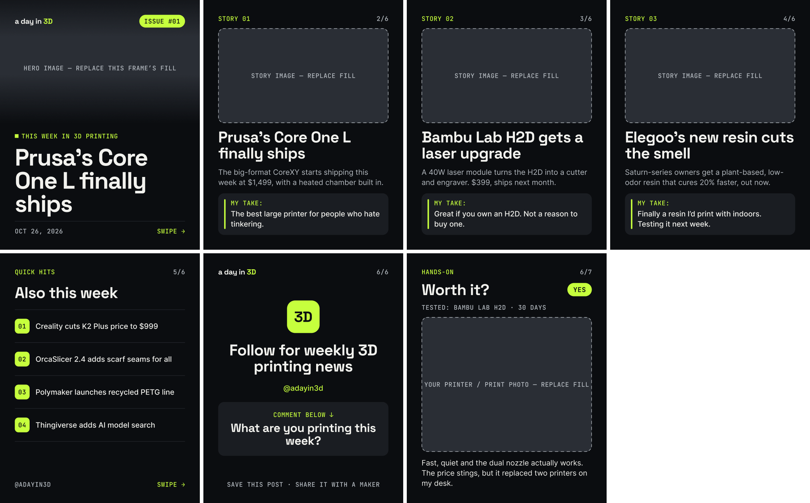
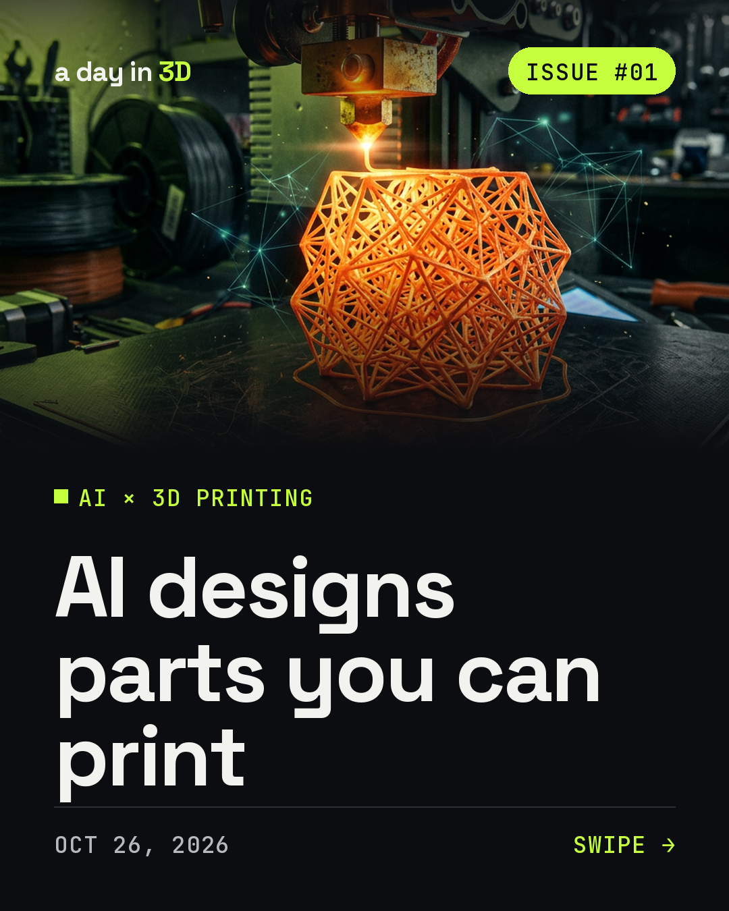

# a day in 3D — Instagram carousel template

Figma file: https://www.figma.com/design/LhwDSvEevMqDDAzPrLPamx

## Pages
- **🧩 Components** — the 5 slide components + `Verdict Pill` (Yes / Maybe / Skip)
- **📱 Example — Issue 01** — full example post built from instances
- **📖 Read Me** — (empty, reserved for notes)

## Format
1080 × 1350 (4:5) slides, 80 px safe margin on every side, all vertical auto layout.

## Brand tokens (variables → collection "Brand")
| Variable | Value | Use |
|---|---|---|
| `color/bg` | `#0B0D10` | slide background |
| `color/surface` | `#1A1D22` | take card, comment card |
| `color/placeholder` | `#2A2E35` | image placeholders |
| `color/accent` | `#C6FF3D` | labels, pills, highlights |
| `color/text/primary` | `#F2F2EE` | headlines, body |
| `color/text/muted` | `#B4BAC0` | summaries, slide numbers, date |
| `color/text/on-accent` | `#0B0D10` | text on lime |
| `color/divider` | `#2A2E35` | rules, dividers |
| `space/safe` · `xl` · `lg` · `md` · `sm` | 80 · 64 · 48 · 32 · 16 | padding / gaps |
| `radius/card` · `radius/pill` | 32 · 999 | corners |

## Text styles
| Style | Font | Size |
|---|---|---|
| Display/Cover | Space Grotesk Bold | 128 |
| Headline/Large | Space Grotesk Bold | 84 |
| Headline/Medium | Space Grotesk Bold | 64 |
| Body/Regular · Body/Medium | Inter | 40 |
| Label/Mono | JetBrains Mono Medium, uppercase | 34 |
| Label/Pill | JetBrains Mono Bold, uppercase | 36 |
| Brand/Wordmark · Brand/Mark | Space Grotesk Bold | 40 · 80 |

## Component properties (swap these each week)
| Component | Text properties | Toggles |
|---|---|---|
| Slide/01 Cover | Headline, Issue, Date, Kicker | Show image hint |
| Slide/02 Story | Headline, Summary, Take, Slide #, Kicker | Show image hint |
| Slide/03 Quick Hits | Headline, Hit 1–4, Slide #, Handle | Show hit 4 |
| Slide/04 Worth It | Headline, Product, Opinion, Slide # | Show image hint, Verdict (nested pill) |
| Slide/05 CTA | Headline, Handle, Comment prompt, Slide # | — |

## Weekly workflow
1. Duplicate the `Issue 01` section on the example page and rename it.
2. Edit the text properties in the right-hand panel.
3. Select each image frame (`Hero Image`, `Story Image`, `My Photo`) → set fill to your photo → toggle **Show image hint** off.
4. Export each slide as PNG at 1×.

## Content limits that keep the layout clean
- Cover headline: ≤ ~35 characters (3 lines at 128 px)
- Story headline: ≤ 8 words; summary ≤ ~90 characters (2 lines); take ≤ 1–2 lines
- Quick hits: ≤ ~40 characters each

## AI imagery (hi3D)
Test cover with an AI-generated hero (Nano-Banana 2, 3:4, 4 points):

Prompt pattern that matched the brand: *cinematic close-up, dark moody workshop, lime green rim light, shallow depth of field, photorealistic, high contrast, no text, no logos* + the story subject.

Cost per image: Seedream v4.5 = 3 pts · Nano-Banana 2 = 4 · Nano-Banana-Pro = 6 · GPT Image 2 = 10.

`tools/render_cover.py` renders a finished 1080×1350 cover outside Figma:
`python3 tools/render_cover.py <fonts-dir> <hero.png> <out.png> "Headline"` (fonts: Space Grotesk, JetBrains Mono variable TTFs from google/fonts).
